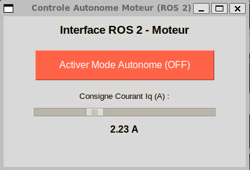

# Pont de Contrôle Autonome ROS 2 via SWD - Black ENIMIA

Ce dossier contient l'interface ROS 2 (Jazzy) pour le contrôle autonome du moteur et l'acquisition de la télémétrie en temps réel en utilisant un pont SWD (Serial Wire Debug) via `pyOCD`.

## 1. Contexte et Motivation

Initialement, l'objectif était d'utiliser Micro-ROS directement sur le microcontrôleur (STM32G431). Cependant, en raison des limitations de RAM et de la complexité de compilation avec l'environnement existant, une architecture alternative a été développée.

Cette approche utilise le programmateur **ST-Link (SWD)** comme un pont de communication temps réel pour :
- Écrire les consignes de contrôle (`autonomousMode` et `autonomousTorque`/Iq) **directement dans la mémoire RAM**.
- Lire la télémétrie en temps réel (Vitesse, Courant mesuré, Puissance, Défauts) depuis les adresses de la structure logicielle du moteur, à une fréquence de 10 Hz.

> **Note Historique :** Ce système a été développé et testé sur le banc moteur du prototype **ENIMIA X Edition**. Il est conçu pour être la brique de base du contrôle moteur pour le futur véhicule autonome de l'équipe : **Black ENIMIA**.

## 2. Contenu du Dossier

*   `extract_members.py` : Script utilitaire basé sur `pyelftools` qui a servi à scanner le fichier `.elf` compilé pour localiser dynamiquement les adresses mémoire des variables critiques.
*   `motor_swd_bridge.py` : Le nœud ROS 2 (HAL). Il lit et écrit dans la RAM du STM32 via `pyOCD`. Il s'abonne aux topics de contrôle et publie la télémétrie au format JSON sur le topic `/motor/telemetry`.
*   `motor_gui.py` : L'interface graphique (Tkinter) servant de station de contrôle principale. **C'est le seul point d'entrée nécessaire pour les tests**.

## 3. Comment Tester (Banc ENIMIA X Edition)

### Prérequis (Windows / WSL)
1.  **Brancher le ST-Link (V2).**
2.  **Attacher l'USB à WSL2** : Ouvrez un terminal PowerShell en mode Administrateur sous Windows et exécutez :
    ```powershell
    usbipd list
    usbipd attach --wsl --busid <BUSID_DU_STLINK>
    ```
    *Note: Sur Linux / WSL, assurez-vous d'avoir les droits de lecture sur le périphérique USB (ex: `sudo chmod -R 777 /dev/bus/usb`).*

### Lancement Simplifié
Ouvrez un terminal WSL et exécutez l'interface graphique. **Le pont SWD démarrera et s'arrêtera automatiquement en arrière-plan.**

```bash
cd ~/chemin/vers/black_enimia_swd_control
source /opt/ros/jazzy/setup.bash
python3 motor_gui.py
```

<div align="center">
  
</div>

### Fonctionnalités de l'Interface
*   **Contrôle** : Activation du mode autonome, injection du courant de consigne (Iq) avec sécurité logicielle intégrée (limite 7A).
*   **Télémétrie en Temps Réel** : Visualisation instantanée de `CurrentFaults`, `SpeedVirtual`, `Iq (Mesuré)`, `Power (W)`, etc.
*   **Automatisation** : La fermeture de la fenêtre coupe proprement les moteurs, désactive la connexion USB et libère le pont SWD.

## 4. Intégration pour l'Architecture du Véhicule "Black ENIMIA"

Dans le cadre du prototype final **Black ENIMIA**, ce système SWD a vocation à s'intégrer de manière transparente avec l'architecture de navigation globale :

1.  **Remplacement de l'IHM (GUI)** : L'interface `motor_gui.py` ne sera utilisée que pour le débogage. Dans le véhicule, les **nœuds de contrôle du système de conduite autonome** (contrôleur MPC, Nav2) publieront sur les topics :
    *   `/motor/autonomous_mode` (`std_msgs/msg/Int32`)
    *   `/motor/autonomous_torque` (`std_msgs/msg/Float32`)
2.  **Acquisition de Télémétrie Centralisée** : Le système d'odomètrie et de sécurité du véhicule pourra s'abonner au topic `/motor/telemetry` pour surveiller l'état matériel en direct, réagir aux défauts matériels (Faults), et utiliser la vitesse mesurée pour la boucle de localisation.
3.  **Abstraction Matérielle (HAL)** : Le script `motor_swd_bridge.py` fonctionnera comme un pilote matériel. Pour le reste du système ROS 2 (LiDAR, Caméras, Navigation), le moteur apparaîtra comme un simple actionneur intelligent, masquant complètement la complexité de l'injection en RAM via SWD.
4.  **Performances** : Ce pont tournera en arrière-plan sous Linux (embarqué sur Raspberry Pi ou Jetson), assurant une liaison très rapide (SWD à 4MHz) et isolant le code critique bas-niveau des processus de calcul autonomes lourds.
